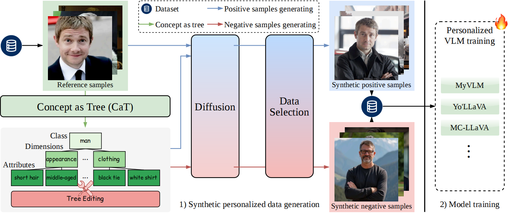

# Concept-as-Tree: A Controllable Synthetic Data Framework Makes Stronger Personalized VLMs

Official implementation of [**Concept-as-Tree: A Controllable Synthetic Data Framework Makes Stronger Personalized VLMs**]



## Abstract
Vision-Language Models (VLMs) have demonstrated exceptional performance in various multi-modal tasks. Recently, there has been an increasing interest in improving the personalization capabilities of VLMs. To better integrate user-provided concepts into VLMs, many methods use positive and negative samples to fine-tune these models. However, the scarcity of user-provided positive samples and the low quality of retrieved negative samples pose challenges for existing techniques. To reveal the relationship between sample and model performance, we systematically investigate the amount and diversity impact of positive and negative samples (easy and hard) on VLM personalization tasks. Based on the detailed analysis, we introduce Concept-as-Tree (CaT), which represents a concept as a tree structure, thereby enabling the data generation of positive and negative samples with varying difficulty and diversity, and can be easily extended to multi-concept scenarios. With a well-designed data filtering strategy, our CaT framework can ensure the quality of generated data, constituting a powerful pipeline. We perform thorough experiments with various VLM personalization baselines to assess the effectiveness of the pipeline, alleviating the lack of positive samples and the low quality of negative samples. Our results demonstrate that CaT equipped with the proposed data filter significantly enhances the capabilities of VLMs across personalization benchmarks. To the best of our knowledge, this work is the first controllable synthetic data pipeline for VLM personalization. 

## Installation
1. Clone this repository:
```shell
git clone https://github.com/zengkaiya/CaT.git
cd CaT
```
2. Set up your Python environment:

```shell
conda create -n cat python=3.10 -y
conda activate cat
pip install -r requirements.txt
```

## Synthetize Your Own Data
### Upload Concept Images
1. Create a new directory under the `dataset` folder, such as `your_dog`, and upload 1 to 3 images of your dog to the `image` subdirectory.

### Use the CaT Framework to Synthesize Concept Trees and Image Prompts
1. Navigate to the `cat` directory. You can sequentially run `get_caption.py`, `get_tree.py`, `change_tree.py`, `pos_prompt.py`, `easy_neg_prompt.py`, and `hard_neg_prompt.py` to obtain the concept tree and its positive and negative sample prompts for a specific concept.
2. Make sure to set your `api_key` and choose the appropriate API model.

### Synthesize and Filter New Positive and Negative Samples
1. Go to the `generation` directory. We use [Dreambooth](https://arxiv.org/abs/2208.12242) to fine-tune the Flux model (though you can choose other generative models as well).
2. Follow the instructions in `README_flux.md` to configure the environment required for fine-tuning the model.
3. Download the [Flux](https://huggingface.co/black-forest-labs/FLUX.1-dev) model needed for synthesizing samples, and the [CLIP](https://huggingface.co/openai/clip-vit-large-patch14-336) model required for filtering.
4. Run `bash finetune_flux.sh` to fine-tune the diffusion model.
5. Use `generate.py` to synthesize new samples, including positive samples for a specific concept, complex negative samples, and simple negative samples shared by all concepts.
6. Use `filter.py` to filter all synthesized samples. You can set `delta` for different levels of filtering.

## Personalize Your VLMs
1. After synthesizing a rich set of personalized samples, you can proceed to obtain a personalized VLM. Here are some methods you can use: [MC_LLaVA](https://github.com/arctanxarc/MC-LLaVA), [YoLLaVA](https://github.com/WisconsinAIVision/YoLLaVA), and [MyVLM](https://github.com/snap-research/MyVLM).


## Citation

If you find CaT is useful in your research or applications, please consider giving us a star 🌟 and citing it by the following BibTeX entry.

```bibtex
@article{an2025concept,
  title={Concept-as-Tree: A Controllable Synthetic Data Framework Makes Stronger Personalized VLMs},
  author={An, Ruichuan and Zeng, Kai and Lu, Ming and Yang, Sihan and Zhang, Renrui and Ji, Huitong and Liang, Hao and Zhang, Wentao},
  journal={arXiv preprint arXiv:2503.12999},
  year={2025}
}
```

## Acknowledgement

This project is benefited from the following repositories:
- [SSDLLM](https://github.com/llm-as-dataset-analyst/SSDLLM)
- [Dreambooth](https://github.com/google/dreambooth)
- [Diffusers](https://github.com/huggingface/diffusers)
- [DeYO](https://github.com/Jhyun17/DeYO)

Thanks for their great works!